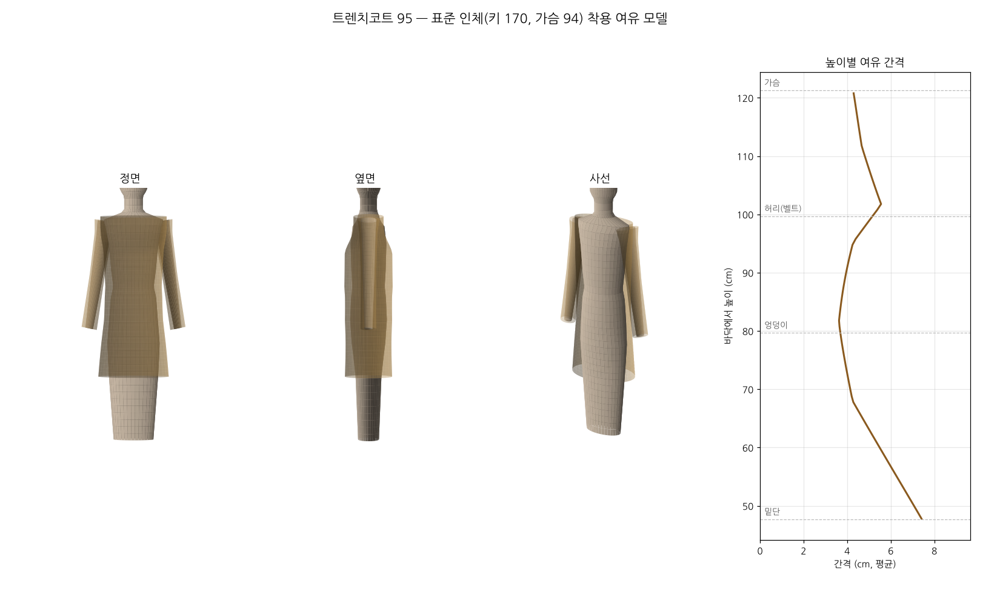

# 트렌치코트 95 검증 결과

## 1. 가상 봉제 (꿰매는 선 길이 비교)

| 봉제선 | A | B | 차이 | 목표 | 판정 |
|---|---|---|---|---|---|
| 어깨선 (뒤 − 앞) | 14.2 | 13.3 | +0.9 | +0.3~+1.0 (뒤 어깨에 오그림 여유 0.3~1cm) | 통과 |
| 옆선 (뒤 − 앞) | 73.8 | 73.8 | +0.0 | -0.3~+0.3 (같아야 함) | 통과 |
| 소매산 − 진동둘레 | 55.9 | 52.9 | +3.0 | +2.0~+4.0 (코트 소매산 여유 2~4cm) | 통과 |
| 소매 앞솔기 (윗 − 밑) | 52.4 | 52.3 | +0.0 | +0.0~+0.8 (윗소매 팔꿈치 여유 0~0.8cm) | 통과 |
| 소매 뒷솔기 (윗 − 밑) | 55.4 | 55.4 | +0.0 | -0.3~+1.0 (윗소매 팔꿈치 여유 0~1cm) | 통과 |
| 칼라밴드 아랫선 − 목둘레선 | 26.7 | 26.7 | +0.0 | -0.5~+0.5 (같아야 함) | 통과 |
| 칼라 아랫선 − 칼라밴드 윗선 | 26.4 | 26.2 | +0.3 | -0.5~+0.8 (같거나 칼라가 약간 김) | 통과 |
| 안단 앞단 − 앞판 앞단 | 102.0 | 102.0 | +0.0 | -0.1~+0.1 (같아야 함) | 통과 |
| 소매 밑단 (윗+밑) − 설계값 | 33.7 | 33.7 | +0.0 | -0.3~+0.3 (설계 둘레와 같아야 함) | 통과 |

## 2. 인체 대비 여유분

| 부위 | 인체 | 옷 | 여유 | 권장 | 판정 |
|---|---|---|---|---|---|
| 가슴둘레 | 94.0 | 118.0 | +24.0 | 16~26 (트렌치코트 일반 16~26cm (버버리 켄싱턴 약 10~12)) | 통과 |
| 허리둘레 (벨트로 조임) | 80.0 | 114.8 | +34.8 | 20~40 (벨트로 조이는 디자인이라 넉넉해도 됨) | 통과 |
| 엉덩이둘레 | 94.0 | 117.2 | +23.2 | 14~30 (앉고 걸을 여유) | 통과 |
| 밑단둘레 (무릎 위) | 95.0 | 130.0 | +35.0 | 30~60 (보폭 여유 (뒤트임 별도)) | 통과 |
| 목둘레 (앞중심까지) | 39.0 | 48.3 | +9.3 | 6~11 (재킷 위에 입는 코트 6~11cm) | 통과 |
| 어깨너비 | 43.2 | 45.2 | +2.0 | 0.5~4 (패드 포함 코트 0.5~4cm) | 통과 |
| 위팔둘레 | 30.0 | 38.8 | +8.8 | 6~12 (재킷 위에 입을 여유) | 통과 |
| 소매부리 | 16.6 | 33.7 | +17.1 | 12~22 (손이 빠지고 재킷 소매가 들어갈 여유) | 통과 |
| 진동깊이 (옆목점→겨드랑이) | 20.2 | 26.4 | +6.2 | 3~7 (코트는 몸보다 3~7cm 깊게) | 통과 |
| 소매길이 (어깨점→손목) | 62.0 | 65.0 | +3.0 | 1.5~4.5 (손목을 덮는 길이) | 통과 |

